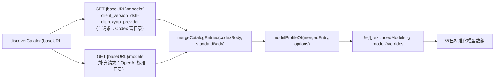

# `@gray0128/dsh-cliproxyapi-provider` 模型参数探测与自动调整改造方案

本文档定义 `@gray0128/dsh-cliproxyapi-provider` 在模型目录探测、参数自动推导、推理档位映射与按模型参数覆盖四个方面的改造方案。本方案基于《[同类插件模型参数探测与自动调整机制调研](./model-parameter-survey.md)》中的实测结论制定，面向本仓库的研发与代码审阅人员。

## 1. 改造目标与设计边界

### 1.1 改造目标

1. **补齐单轮最大输出上限（`maxTokens`）**：结合 CLIProxyAPI 标准 `/v1/models` 与 Codex `/v1/models?client_version=...` 两套响应数据，消除所有模型在 Codex 目录端点下因缺少输出上限字段而全部退化为 `32768` 的问题。
2. **兼容双目录格式与异构字段名**：支持解析 `{ models: [...] }` 与 `{ data: [...] }` 两种目录结构，识别 Claude、Codex、Gemini、Vertex、Kimi、xAI、Antigravity 各渠道的窗口、输出上限、输入模态与思考配置字段。
3. **消除推理档位别名覆盖冲突**：确保同名标准档位（如 `max`）优先于别名映射（如 `ultra -> max`），不受上游数组排列顺序影响；补充对标准目录 `thinking.levels` 与 `thinking.zero_allowed` 的解析。
4. **支持按模型覆盖参数与过滤模型**：在插件配置中支持隐藏指定模型（`excludedModels`）及按模型覆盖容量、模态和推理能力（`modelOverrides`），且在定时刷新时不丢失。
5. **保留前端首次引导的完整模型能力**：在 `client.js` 写入初始 Profile 时保留已探测到的 `input` 与 `reasoningEfforts` 字段。

### 1.2 设计边界（不做什么）

- **不自建请求流适配器或本地 HTTP 代理**：插件保持「单一目录所有者」定位，仅维护 `llm-pi-ai` 命名空间下的 `providers.CLIProxyAPI` 配置，流式请求、多模态降级投影与重试继续由宿主 `@deepseek-ai/dsh-llm` 与 `@deepseek-ai/dsh-llm-pi-ai` 执行。
- **不引入主动推理探测（Active Probing）**：CLIProxyAPI 已在目录接口中直接返回模型的 `supported_reasoning_levels` 或 `thinking.levels`，无需像 `dsh-workbuddy-connect` 那样向网关发送消耗额度的测试对话请求。
- **不依赖外部在线元数据服务**：CLIProxyAPI 二进制已内嵌各渠道模型的精确容量与思考定义，插件直接从用户配置的 CLIProxyAPI 实例获取元数据，不额外请求 `models.dev`。

## 2. 系统改造设计

### 2.1 双端点目录融合与异构字段提取（`src/catalog.js` 与 `src/index.js`）

#### 工作流程



1. **双源拉取与降级策略**：
   - `discoverCatalog` 发起主请求 `GET {baseURL}/models?client_version=dsh-cliproxyapi-provider`，并并行发起补充请求 `GET {baseURL}/models`。
   - 当两个请求均成功时，以模型 `id`（`slug ?? id ?? model`）为键，将标准目录 `{ data: [...] }` 中的字段补充到 Codex 目录 `{ models: [...] }` 对应条目下（Codex 目录已有的非空字段优先，缺失的 `max_completion_tokens`、`outputTokenLimit`、`thinking` 等从标准目录补齐）。
   - 当补充请求 `GET {baseURL}/models` 失败或返回非 JSON 时，忽略补充错误，仅使用主请求结果完成解析。
   - 当主请求失败或返回的响应不含 `models` 数组，但标准目录请求成功返回 `{ data: [...] }` 时，直接使用标准目录生成模型列表，保障挂载了标准 OpenAI 兼容网关时的可用性。

2. **字段归一化优先级表**：

| 目标字段 | 候选源字段探查顺序（首个有效值生效） | 约束与回退规则 |
| --- | --- | --- |
| `id` | `entry.slug` → `entry.id` → `entry.model` | 非空去首尾空白字符串；缺失或 `visibility === 'hide'` 时跳过 |
| `name` | `entry.display_name` → `entry.displayName` → `entry.name` → `entry.description` → `id` | 非空字符串 |
| `contextWindow` | `modelOverride.contextWindow` → `entry.max_context_window` → `entry.context_window` → `entry.context_length` → `entry.inputTokenLimit` → `entry.max_input_tokens` → `options.defaultContextWindow` | 正整数；默认回退 `262144` |
| `maxTokens` | `modelOverride.maxTokens` → `entry.max_output_tokens` → `entry.max_completion_tokens` → `entry.outputTokenLimit` → `entry.max_tokens` → `options.defaultMaxTokens` | 正整数；默认回退 `32768`；若未显式配置 `modelOverride.maxTokens`，最终值取 `Math.min(contextWindow, resolvedMaxTokens)` |
| `input` | `modelOverride.input` → `entry.input_modalities` → `entry.supportedInputModalities` → `options.defaultInput` | 仅保留 `'text'` 与 `'image'` 并去重；为空时回退 `options.defaultInput`（默认 `['text']`） |
| `reasoningEfforts` | `modelOverride.reasoningEfforts` → `entry.supported_reasoning_levels` → `entry.thinking` | 见 2.2 节归一化规则 |

### 2.2 推理档位归一化与无冲突映射（`src/catalog.js`）

在 `reasoningEffortsOf(entry)` 中按以下顺序解析推理能力：

1. **提取原始档位集合**：
   - 若 `Array.isArray(entry?.supported_reasoning_levels)` 为真，提取其中的字符串或 `item.effort` 字段。
   - 否则若 `Array.isArray(entry?.thinking?.levels)` 为真，提取其中的字符串列表；若同时声明了 `entry.thinking.zero_allowed === true` 且列表中不含 `'off'` 或 `'none'`，将 `'none'` 追加到候选列表。
2. **两阶段无冲突映射**：
   - **第一阶段（标准同名档位优先）**：遍历候选值，若转小写后直接命中 `CANONICAL_REASONING_LEVELS`（`'off'`、`'minimal'`、`'low'`、`'medium'`、`'high'`、`'xhigh'`、`'max'`），写入 `efforts[canonical] = canonical === 'off' ? 'none' : canonical`。
   - **第二阶段（别名补位）**：再次遍历候选值处理别名（`'none'` 对应 `canonical: 'off', wire: 'none'`；`'ultra'` 对应 `canonical: 'max', wire: 'ultra'`）。仅当目标 `canonical` 尚未在第一阶段被占用时才写入 `efforts`。由此保证当模型同时提供 `max` 与 `ultra` 时，无论二者在数组中顺序如何，始终优先保留标准 `'max': 'max'`；仅提供 `ultra` 时映射为 `'max': 'ultra'`。
3. **有效性收敛**：若最终 `efforts` 为空，或所有键均为 `'off'`，返回 `undefined`（作为非推理模型处理）。

### 2.3 按模型参数覆盖与模型过滤（`src/index.js` 与 `src/catalog.js`）

在 [`src/index.js`](../src/index.js#L22-L31) 的 `Config` Schema 中新增两个可选配置项：

```js
const ModelOverrideSchema = z.object({
  name: z.string(),
  contextWindow: z.number().step(1).min(1),
  maxTokens: z.number().step(1).min(1),
  input: z.array(z.union(['text', 'image'])),
  reasoningEfforts: z.union([
    z.const(false),
    z.dict(z.string()),
  ]),
}).partial()

export const Config = z.object({
  defaultContextWindow: z.number().step(1).min(1).default(262144),
  defaultMaxTokens: z.number().step(1).min(1).default(32768),
  defaultInput: z.array(z.union(['text', 'image'])).default(['text']),
  excludedModels: z.array(z.string()).default([]),
  modelOverrides: z.dict(ModelOverrideSchema).default({}),
  headers: z.dict(z.string()).default({}),
  fetchTimeoutMs: z.number().step(1).min(1).default(15000),
  retryInitialMs: z.number().step(1).min(1).default(3000),
  retryMaxMs: z.number().step(1).min(1).default(60000),
  refreshIntervalMs: z.number().step(1).min(0).default(300000),
})
```

覆盖与过滤执行规则：

1. **模型过滤（`excludedModels`）**：支持精确匹配模型 `id` 与前缀/后缀通配符 `*`（例如 `'*-preview'`、`'gpt-5.1'`，与 CLIProxyAPI 服务端 `excluded-models` 语法保持一致）。命中的模型在目录构建阶段直接跳过。
2. **单模型参数覆盖（`modelOverrides`）**：
   - 若 `override.contextWindow` 或 `override.maxTokens` 存在，直接采用覆盖值。
   - 若 `override.input` 存在且非空，去重后采用覆盖值。
   - 若 `override.reasoningEfforts === false`，移除该模型的 `reasoningEfforts` 字段（强制声明为非推理模型）；若为非空字典，经 `normalizeReasoningLevel` 校验后替换该模型的 `reasoningEfforts`。
3. **刷新指纹同步（`refreshKeyOf`）**：将 `config.excludedModels` 与 `config.modelOverrides` 纳入 `refreshKeyOf(profile, config)` 计算，确保修改 `cordis.patch.yml` 后能立即触发同步更新。

### 2.4 前端引导保留完整能力（`client.js`）

修改 [`client.js`](../client.js#L203-L223) 中的 `bootstrapProfileOf`：

```js
function bootstrapProfileOf(baseURL, models, hasCredential, syncToken) {
  return {
    displayName: PROVIDER,
    api: 'openai-responses',
    baseURL,
    models: models.map((model) => ({
      id: model.id,
      name: model.name || model.id,
      contextWindow: model.contextWindow || 262144,
      maxTokens: model.maxTokens || 32768,
      ...(Array.isArray(model.input) && model.input.length ? { input: model.input } : {}),
      ...(model.reasoningEfforts && Object.keys(model.reasoningEfforts).length
        ? { reasoningEfforts: model.reasoningEfforts }
        : {}),
    })),
    defaultContextWindow: 262144,
    defaultMaxTokens: 32768,
    defaultInput: ['text'],
    headers: {
      [PROFILE_SYNC_HEADER]: 'rich:' + syncToken,
      ...(hasCredential ? {} : { authorization: PLACEHOLDER_AUTHORIZATION }),
    },
    ...(hasCredential ? { apiKeyEnv: CREDENTIAL_REF } : {}),
  }
}
```

## 3. 治理规则与禁止项

1. **双源合并主键不变量**：合并 Codex 目录与标准 `/v1/models` 目录时，`MUST` 使用去首尾空白后的精确模型 ID（Codex 条目的 `slug ?? id ?? model` 与标准条目的 `id`）进行关联，`禁止` 按 `display_name` 模糊匹配。若违反该规则，同名展示的不同模型变体（如不同渠道下的同名别名）会发生容量参数串扰。
2. **输出上限不超越窗口不变量**：在未配置显式 `modelOverrides[id].maxTokens` 时，推导出的 `maxTokens` `MUST` 满足 `maxTokens <= contextWindow`。当 `defaultMaxTokens`（如 `32768`）大于某个小窗口模型的 `contextWindow`（如 `16384`）时，自动将 `maxTokens` 压低至 `contextWindow`，防止下游请求因输出预算超过总窗口被网关以 HTTP 400 拒绝。
3. **无效覆盖配置快速失败不变量**：当用户在 `modelOverrides[id].reasoningEfforts` 中传入空对象 `{}` 或仅含 `off` 的对象时，插件在构建目录阶段 `MUST` 抛出明确错误或忽略该无效覆盖，严禁将非法 `reasoningEfforts` 传给 `PiAiConfig` 导致整个提供方同步崩溃。
4. **保持既有宿主不变量**：《[同类插件模型参数探测与自动调整机制调研](./model-parameter-survey.md#3-治理规则与不变量)》第 3 节定义的 5 项不变量（单一目录所有权、推理映射非空有效、4 MiB 响应上限、无密钥占位鉴权、配置变更幂等写入）在改造后必须全部保持不变。

## 4. 实施步骤与验收标准

### 4.1 实施步骤

1. **改造 `src/catalog.js`**：
   - 新增 `mergeCatalogPayloads(codexBody, standardBody)` 或扩展 `readCodexCatalog(body, options, supplementBody)`，支持 `{ models: [...] }` 与 `{ data: [...] }` 双格式解析与按 ID 字段合并。
   - 在 `modelProfileOf` 中扩展 `context_length`、`inputTokenLimit`、`outputTokenLimit`、`supportedInputModalities`、`thinking` 的提取，加入 `Math.min(contextWindow, maxTokens)` 自动约束，并支持应用 `excludedModels`（含 `*` 通配符）与 `modelOverrides`。
   - 在 `reasoningEffortsOf` 中实现标准档位优先于别名映射的两阶段逻辑，并支持从 `thinking.levels` 与 `thinking.zero_allowed` 提取档位。
   - 新增 `standardCatalogURL(baseURL)` 返回 `${base}/models`。
2. **改造 `src/index.js`**：
   - 在 `Config` 中添加 `excludedModels` 与 `modelOverrides` 定义。
   - 在 `discoverCatalog` 中并行请求 `catalogURL(baseURL)` 与 `standardCatalogURL(baseURL)`，实现主从合并与单源降级容错。
   - 在 `refreshKeyOf` 中纳入 `excludedModels` 与 `modelOverrides`。
3. **改造 `client.js`**：
   - 在 `bootstrapProfileOf` 中保留 `discoverModels` 返回的 `input` 与 `reasoningEfforts`。
4. **更新单元测试与文档**：
   - 在 `test/index.test.js` 与 `test/client.test.js` 中补充双端点合并、标准 `{ data: [...] }` 降级、`max`/`ultra` 顺序无关映射、`thinking.levels` 解析、`excludedModels` 过滤、`modelOverrides` 覆盖及小窗口 `maxTokens` 自动收敛的测试用例。
   - 在 `README.md` 与 `README_EN.md` 的配置项表格中补充 `excludedModels` 与 `modelOverrides` 说明。

### 4.2 验收标准

| 编号 | 验收场景 | 输入条件 | 预期输出 / 验收检查点 |
| --- | --- | --- | --- |
| AC-1 | Codex 目录与标准目录合并补齐 `maxTokens` | Codex `/models?client_version=...` 返回 `slug: "gpt-5.6-sol", max_context_window: 372000`（无输出上限）；标准 `/models` 返回 `id: "gpt-5.6-sol", max_completion_tokens: 128000` | 解析出的模型 `contextWindow` 为 `372000`，`maxTokens` 自动调整为 `128000`（而非 `32768`） |
| AC-2 | 标准 OpenAI `/models` 独立降级解析 | 上游仅支持标准 `{ object: "list", data: [...] }`，含 Gemini（`inputTokenLimit: 1048576, outputTokenLimit: 65536`）与 Claude（`context_length: 200000, max_completion_tokens: 64000, thinking: { levels: ["low", "high"], zero_allowed: true }`） | Gemini 解析出 `contextWindow: 1048576, maxTokens: 65536`；Claude 解析出 `contextWindow: 200000, maxTokens: 64000, reasoningEfforts: { off: "none", low: "low", high: "high" }` |
| AC-3 | `max` 与 `ultra` 档位顺序无关性 | 模型 `supported_reasoning_levels` 依次为 `[{ effort: "ultra" }, { effort: "max" }]` | 解析出的 `reasoningEfforts.max` 为 `'max'`；当仅提供 `[{ effort: "ultra" }]` 时，`reasoningEfforts.max` 为 `'ultra'` |
| AC-4 | 小窗口模型 `maxTokens` 自动收敛 | 模型声明 `context_window: 16384`，未声明输出上限，全局 `defaultMaxTokens: 32768` | 推导出的 `maxTokens` 自动收敛为 `16384`（不大于 `contextWindow`） |
| AC-5 | `excludedModels` 与 `modelOverrides` 生效 | 配置 `excludedModels: ["*-preview"]`，`modelOverrides: { "gpt-5.6-sol": { contextWindow: 128000, reasoningEfforts: false } }` | 所有 `-preview` 后缀模型被过滤；`gpt-5.6-sol` 的 `contextWindow` 变为 `128000` 且不包含 `reasoningEfforts` 字段，并能通过 `PiAiConfig` 校验 |
| AC-6 | 自动化检查全部通过 | 运行 `npm run check` | `node --check` 语法检查与 `node --test` 全部单元测试以退出码 `0` 通过 |
